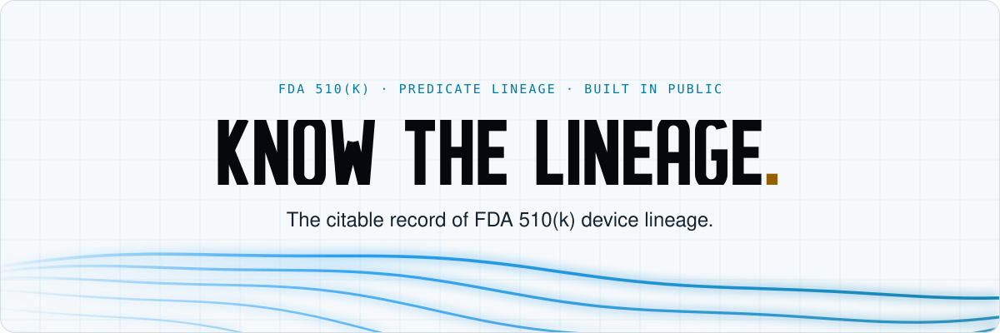
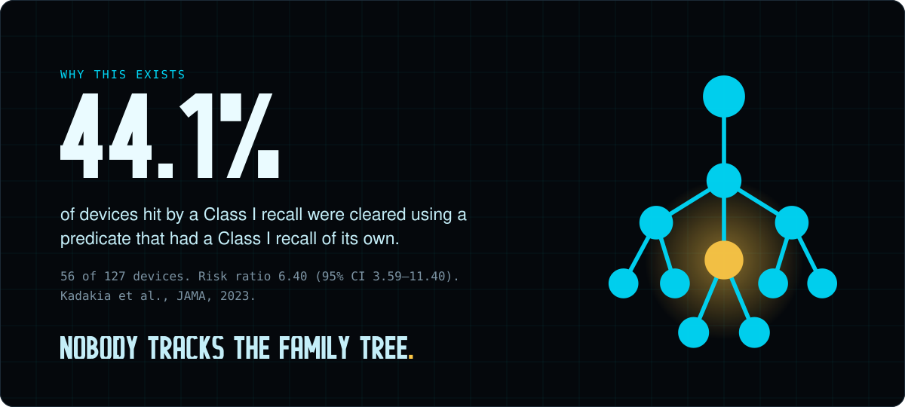
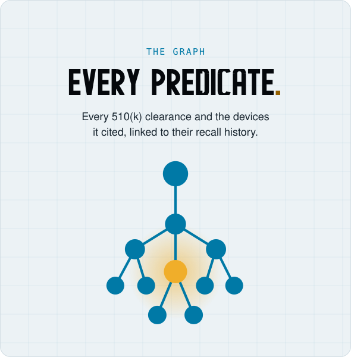
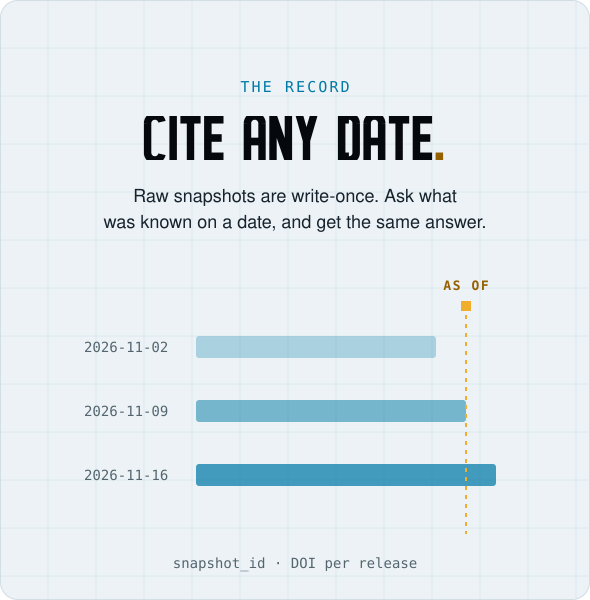
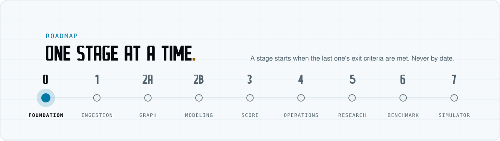
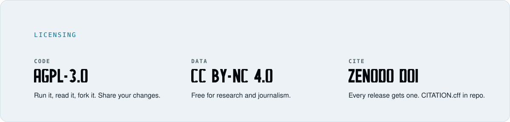

<picture>
  <source media="(prefers-color-scheme: dark)" srcset="./tiles/hero-dark.svg" />
  
</picture>

  <a href="https://filiation.org"><picture><source media="(prefers-color-scheme: dark)" srcset="./tiles/pill-linkedin-dark.svg" /></picture></a>
  &nbsp;
  <a href="https://www.linkedin.com/company/filiation"><picture><source media="(prefers-color-scheme: dark)" srcset="./tiles/pill-website-dark.svg" /></picture></a>
  &nbsp;
  <a href="https://www.youtube.com/@filiationhq"><picture><source media="(prefers-color-scheme: dark)" srcset="./tiles/pill-youtube-dark.svg" /></picture></a>
  &nbsp;
  <a href="https://x.com/filiationhq"><picture><source media="(prefers-color-scheme: dark)" srcset="./tiles/pill-x-dark.svg" /></picture></a>
  &nbsp;
  <a href="mailto:filiationhq@gmail.com"><picture><source media="(prefers-color-scheme: dark)" srcset="./tiles/pill-email-dark.svg" /></picture></a>

<picture>
  <source media="(prefers-color-scheme: dark)" srcset="./tiles/problem-dark.svg" />
  
</picture>

  <picture><source media="(prefers-color-scheme: dark)" srcset="./tiles/graph-dark.svg" /></picture>
  <picture><source media="(prefers-color-scheme: dark)" srcset="./tiles/record-dark.svg" /></picture>

<picture>
  <source media="(prefers-color-scheme: dark)" srcset="./tiles/roadmap-dark.svg" />
  
</picture>

<picture>
  <source media="(prefers-color-scheme: dark)" srcset="./tiles/licensing-dark.svg" />
  
</picture>

Built in public by <a href="https://github.com/stevenrocca3">Steven Rocca</a> (data engineering) and Alden (data science), in Pittsburgh. Not affiliated with the FDA. Tiles generated by <a href="./build.py"><code>profile/build.py</code></a>.

